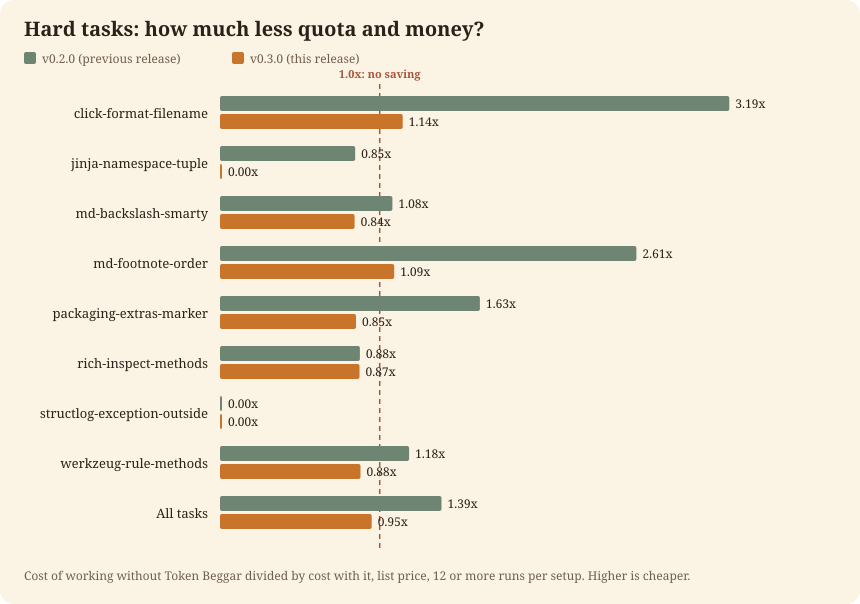
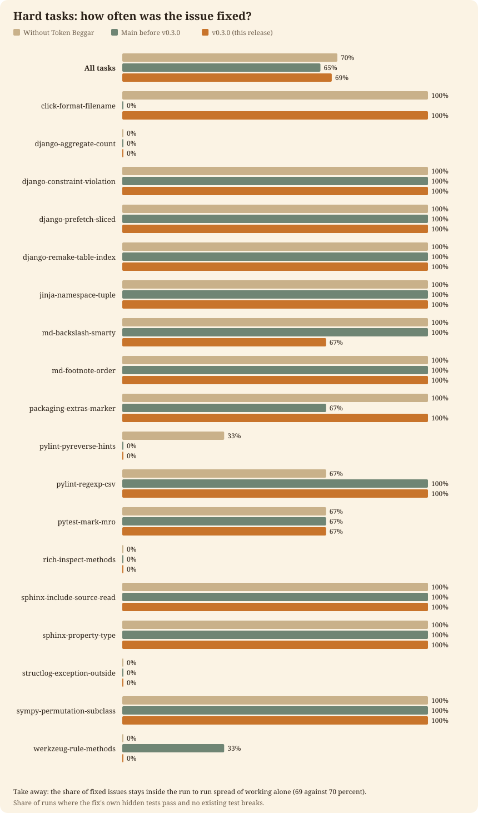

# Token Beggar 🪙: 동일한 답변, 더 적은 청구 금액

<picture>
  <source media="(prefers-color-scheme: dark)" srcset="assets/banner-dark.svg">
  
</picture>

<p align="center">
  <a href="https://github.com/Arthur031221/Token-Beggar/actions/workflows/ci.yml"></a>
  <a href="https://github.com/Arthur031221/Token-Beggar/releases"></a>
  <a href="pyproject.toml"></a>
  <a href="pyproject.toml"></a>
  <a href="LICENSE"></a>
</p>

[English](README.md) | [繁體中文](README.zh-TW.md) | [简体中文](README.zh-CN.md) | [日本語](README.ja.md) | [한국어](README.ko.md) | [Español](README.es.md) | [Français](README.fr.md) | [Deutsch](README.de.md) | [Português](README.pt-BR.md)

Token Beggar는 Claude Code용 플러그인입니다. 대규모 모델이 작업을 수행하기 전에, 더 저렴한 모델도 동일하게 잘 해낼 수 있는지 확인합니다. 소규모 작업은 대화 내에 유지됩니다. 아직 읽어보지 않은 저장소의 버그 수정과 같은 대규모 작업은 더 저렴한 단일 워커에게 전송되며, 대화 모델이 diff 전체를 검토하고 테스트를 실행합니다. 설계, 근본 원인 분석, 최종 답변은 사용자가 선택한 모델이 담당합니다.

**18개의 실제 버그 수정에서 단독 작업 대비 할당량과 비용을 1.42x 절감했으며, 비공개 테스트 통과율도 동일했습니다(69% 대 70%).**

사용자의 로컬 머신에서, Claude Code 세션 내에서 실행됩니다. 이미 로그인된 Claude Code를 사용하며, 사용자에 관한 어떠한 정보도 외부에 전송하지 않고 오직 자체 폴더에만 데이터를 작성합니다. [구체적인 동작 내용](docs/on-your-machine.md).

[설치](#설치) · [빠른 시작](#빠른-시작) · [결과](#결과) · [동작 원리](#동작-원리) · [자주 묻는 질문](#자주-묻는-질문) · [문서](#문서) · [변경 기록](CHANGELOG.md)

<p align="center"></p>

> [!TIP]
> 정상적으로 동작하는지 확실하지 않다면 `token-beggar doctor`를 실행하세요. 라우팅을 조용히 중단시킬 수 있는 요소를 나열하고, 문제가 있으면 종료 코드 1로 종료합니다.

## 설치

Claude Code 및 Python 3.10 이상이 필요합니다. 표준 라이브러리만 사용합니다.

```
# From the marketplace in this repository (inside Claude Code)
/plugin marketplace add Arthur031221/Token-Beggar
/plugin install token-beggar@token-beggar
```

```
# Try it for one session without installing
git clone https://github.com/Arthur031221/Token-Beggar
claude --plugin-dir ./Token-Beggar
```

```
# From a shell, the same two steps as the first block
claude plugin marketplace add Arthur031221/Token-Beggar
claude plugin install token-beggar@token-beggar
```

에이전트를 재시작하거나 `/reload-plugins`를 실행하세요. 스킬을 읽는 다른 에이전트에서 해당 스킬을 사용하는 방법을 포함하여 자세한 내용은 [docs/install.md](docs/install.md)에 나와 있습니다.

## 빠른 시작

평소처럼 작업하세요. 세션의 첫 번째 실질적인 프롬프트에서 훅이 짧은 라우팅 카드를 추가하고, 대화 모델이 작업의 규모를 판단합니다. 라우팅이 수행되고 절감 효과가 측정된 답변의 끝에 한 줄이 표시됩니다:

```
Token Beggar: about 1.4x less quota than Opus 5.5 high alone, saved about $0.21 (est.) | large task | routed 1: haiku medium x1
```

배수는 현재 사용 중인 모델과 effort에 대해 측정된 Token Beggar 미사용 대비 사용 시의 정가 비용 비율입니다. 달러 금액은 해당 답변 자체의 비용에 그 비율에서 1을 뺀 값을 곱한 것입니다. 둘 다 추정치이며 그렇게 명시됩니다. 이 줄은 토큰 수를 계산하지 않으며, 1.15x 미만일 때는 실행 간 편차 범위 내에 있으므로 배수를 표시하지 않습니다.

자동으로 실행되지 않은 프롬프트에서 활성화하려면 `/token-beggar`를 입력하세요. 그런 다음 훅이 실행되는지 확인합니다:

```
token-beggar doctor
```

## 결과

두 가지 설정, 단 두 가지뿐입니다. **Token Beggar 미사용**은 평소 사용하는 방식대로 대화 모델이 단독으로 작업하는 것입니다. **Token Beggar 사용**은 이번 릴리스에 포함된 카드인 버전 0.3.0입니다. 대화 모델로 high effort의 Opus 5.5를 사용했습니다. 비용은 캐시를 포함한 대화 및 모든 워커의 정가 기준입니다. 신뢰구간은 95퍼센트입니다.

고난도 작업은 12개의 오픈 소스 Python 프로젝트(Django, Sphinx, pylint, sympy, click 등)에서 병합된 18개의 풀 리퀘스트입니다. 대화는 수정 전 커밋과 이슈 본문에서 시작되며, 대화 모델에는 표시되지 않는 메인테이너가 추가한 테스트를 통해 채점됩니다. 작업당 3회 실행, 설정당 54회 실행했습니다.

| 설정 | 작업당 비용 | 배수 | 해결된 이슈 |
| --- | --- | --- | --- |
| Token Beggar 미사용 | $0.69 | 1.00x | 70% |
| Token Beggar 사용 | $0.49 | 1.42x 적음 (1.33 to 1.51) | 69% |

<p align="center"></p>

<p align="center"><em>18개 작업 중 17개에서 Token Beggar를 사용했을 때 비용이 적게 들었습니다. 비용이 더 든 1개 작업(structlog-exception-outside)은 약 10% 더 들었습니다.</em></p>

<p align="center"></p>

<p align="center"><em>Token Beggar 없이 70%, 사용 시 69%의 이슈를 해결했습니다. 편차 범위 안에서 동률이며, 설정당 54회 실행했습니다.</em></p>

비용은 29% 줄었고 해결된 이슈 비율은 동등합니다(69% 대 70%는 편차 범위 내 동률입니다). 소요 시간 역시 동등한 수준이며(168초 대 187초), 더 빠르지 않습니다.

소규모 작업은 0.3.0이 아닌 이전 카드로만 측정되었습니다. 거기서도 절감 효과는 거의 없었으며(1.11x로, 절감을 주장하는 기준선인 1.15x 미만), 소규모 작업은 대화 내에 유지되므로 단일 파일의 작은 편집에서는 변화가 거의 없을 것으로 예상해야 합니다.

전체 벤치마크 세부 정보, 작업 목록 및 모든 항목의 재현 방법: [docs/benchmark.md](docs/benchmark.md). 모든 원시 실행 데이터는 [`benchmark/results`](benchmark/results)에 있습니다.

> [!IMPORTANT]
> **효과가 있는 경우와 없는 경우.** Opus 5.5(high effort)의 대규모 작업(측정치 1.42x)과 Fable 5.1의 모든 effort 및 max effort의 Opus에서 효과가 있으며, 이들에서는 소규모 작업에서도 절감이 측정되었습니다. 다른 effort의 Opus 및 Sonnet 5.5에서는 소규모 작업을 대화 내에 유지하고 대규모 작업을 워커에게 보냅니다. 대규모 작업 절감은 Opus high에서만 측정되었으므로 Sonnet에서는 미측정 상태이며 바닥글에는 배수 없이 비용만 표시됩니다. 가장 저렴한 모델인 Haiku 5.5에서는 아무런 작업도 수행하지 않습니다. 주로 단일 파일의 작은 편집을 실행한다면 변화가 거의 없을 것으로 예상해야 합니다.

## 동작 원리

1. **모드 확인.** 대화의 모델과 effort에 따라 `data/measured.json`에서 세 가지 모드 중 하나가 선택됩니다. 소규모 작업에서 1.15x 이상의 절감이 측정되었거나 모델이 측정된 적이 없는 경우 `full`(모델, effort, 외부 도구의 전체 메뉴)입니다. 그 외의 모든 경우는 `sized`입니다. 가장 저렴한 모델의 경우 `off`입니다. `token-beggar mode --all`은 그리드를 출력하며, `TOKEN_BEGGAR_MODE=full|sized|off`로 모드를 강제할 수 있습니다.
2. **작업 규모 판단.** `sized` 모드에서 카드는 소규모 작업의 경우 대화 내에서 수행하고, 대규모 작업의 경우 재현, 탐색, 수정, 테스트 실행 목록 전체를 단일 워커에게 보내도록 안내합니다. 대규모란 모델이 읽지 않은 저장소의 이슈, 약 5회를 초과하는 도구 호출, 둘 이상의 파일, 또는 편집 및 테스트 루프를 의미합니다. 약 5단계를 초과하여 커지는 소규모 작업은 대규모 작업이 됩니다.
3. **워커 작업물 확인.** 워커는 150단어 미만으로 보고하고 동일한 증상을 공유하는 모든 위치를 나열합니다. 대화 모델은 전체 `git diff`를 읽고, 테스트를 실행하며, 해당 목록을 확인하고, 빠진 부분이 있으면 동일한 워커에게 다시 보냅니다.
4. **상한선 준수.** 대화의 모델과 effort는 동일 벤더의 모델이 받을 수 있는 상한선을 제한합니다. Sonnet medium에서는 어떤 작업도 Opus나 high effort로 전달되지 않습니다.
5. **보고.** Stop 훅이 바닥글을 추가합니다. 모델이 직접 작성하는 것이 아니므로 텍스트 안에서 숫자가 임의로 꾸며질 수 없습니다.

임계값의 출처: 1.15x는 반복 실행에서 확인된 실행 간 편차에 해당하므로, 이보다 작은 비율은 절감으로 부르지 않습니다. 대규모 작업 비율인 1.42x는 위의 고난도 벤치마크 결과입니다. 자세한 내용은 [docs/benchmark.md](docs/benchmark.md#models-and-efforts)를 참조하세요.

### 전체 구성

- **Skill**: 대화 모델이 읽는 라우팅 규칙입니다. [`skills/token-beggar/SKILL.md`](skills/token-beggar/SKILL.md), 설명은 [docs/usage.md](docs/usage.md)에 있습니다.
- **Hooks**: 카드를 추가하고, 워커의 상한선을 유지하며, 압축을 보호하고, 바닥글을 추가하는 7개의 작은 훅입니다. [docs/on-your-machine.md](docs/on-your-machine.md).
- **Worker**: 위임된 작업을 수행하는 6개의 도구를 가진 단일 에이전트입니다. [`agents/beggar-worker.md`](agents/beggar-worker.md), [docs/architecture.md](docs/architecture.md)를 참조하세요.
- **CLI**: `doctor`, `mode`, `stats`, `inventory`, `ask` 등을 제공하는 `token-beggar`입니다. [docs/usage.md](docs/usage.md#commands).

또한 긴 세션을 보호합니다. 호스트가 컨텍스트를 압축하는 지점을 감지하여 그 전에 짧은 메모를 저장하도록 대화에 요청하고, 단계 중간에 발생하는 자동 압축을 연기할 수 있으며, 압축 후 메모를 다시 복원합니다. [docs/architecture.md](docs/architecture.md)를 참조하세요.

## 로컬 머신에서의 동작

> [!NOTE]
> 아래의 모든 내용은 훅 표와 함께 [docs/on-your-machine.md](docs/on-your-machine.md)에도 나와 있습니다.

- **읽기**: 현재 세션의 트랜스크립트(비용 계산, 컨텍스트 크기 및 모델 확인용), `ps`를 통한 대화 프로세스의 실행 플래그, 모델과 effort에 대한 환경 및 설정 파일. 이 중 어떤 것도 머신 외부로 유출되지 않습니다.
- **실행**: `python3 -m token_beggar hook <name>`을 호출하는 7개의 훅. 실패한 훅은 오류를 기록하고 종료 코드 0으로 종료하므로 세션을 손상시키지 않습니다. 워커는 사용자의 고유한 권한 설정 하에서 실행됩니다.
- **전송**: 가격을 최신 상태로 유지하기 위한 벤더의 공개 모델 페이지에 대한 주 1회 다운로드(`TOKEN_BEGGAR_OFFLINE=1`로 중지 가능). 텍스트가 외부 AI 도구(`agy`, `gemini`, `codex`)로 전달되는 경우는 사용자가 해당 도구를 설치하고 명시적으로 지정했거나, 읽기 분량이 약 100k 토큰 이상인 경우뿐입니다. 키처럼 보이는 파일 이름과 텍스트는 거부됩니다.
- **쓰기**: 단 하나의 폴더인 `~/.claude/token-beggar`. 에이전트 설정이나 프로젝트 내 파일은 수정하지 않습니다.
- **비활성화**: 단일 셸의 경우 `TOKEN_BEGGAR=off`, 영구적으로는 해당 폴더에 `off`라는 이름의 파일 생성, 또는 `/plugin uninstall token-beggar`.

## 설정

아무것도 설정할 필요가 없습니다. 기본값은 측정 결과에서 가져옵니다.

| 설정 | 동작 내용 |
| --- | --- |
| `TOKEN_BEGGAR=off` | 이 셸에서 비활성화 |
| `TOKEN_BEGGAR_MODE=full\|sized\|off` | 측정된 모드 대신 특정 모드 강제 적용 |
| `TOKEN_BEGGAR_EARLY=1` | 긴 세션에서 조기 압축 제안(측정 결과 비용이 더 발생하여 기본값은 끔) |
| `TOKEN_BEGGAR_OFFLINE=1` | 주간 다운로드 건너뛰기 |
| `token-beggar cap agy flash` | 외부 도구를 flash 모델로 제한 |

"no gemini"와 같은 프롬프트를 포함한 전체 내용: [docs/config.md](docs/config.md).

## 제한 사항

- 소규모 작업은 거의 절감되지 않습니다. 약 1.15x 미만은 절감이 없는 것과 구분할 수 없으며, 이전 카드의 소규모 작업 결과(1.11x)는 이에 미치지 못합니다.
- 고난도 벤치마크는 단 하나의 대화 모델 및 effort(Opus 5.5, high)와 Python 프로젝트만을 다룹니다. 대규모 작업에서 Sonnet, Haiku, Fable은 측정되지 않았습니다.
- 69% 대 70% 해결률은 편차 범위 내에서 대등하며, 소형 모델을 통한 블라인드 검토에서 v0.3.0의 diff는 단독 작업보다 낮은 평가를 받았고(0에서 2 척도 기준 0.94 대 1.33), 테스트와의 일치도 약했으므로 코드가 동등하게 훌륭하다는 점은 입증되지 않았습니다.
- v0.3.0은 소규모 작업에서 재실행되지 않았습니다.
- 작은 파일에서는 외부 AI 도구를 통한 절감 효과가 발견되지 않았으며, Gemini는 측정되지 않았습니다. 대규모 읽기는 측정되지 않았습니다.
- 테스트된 단 한 번의 긴 세션에서 조기 압축은 비용이 더 발생했으므로 선택 사항(opt-in)입니다.
- 바닥글은 사용자의 작업이 아닌 측정된 비율로부터 추정됩니다. 훅은 대화 모델을 직접 확인할 수 없으므로 트랜스크립트, 프로세스 플래그, 환경 및 설정 순으로 읽습니다. 어디에도 명시되어 있지 않으면 카드에 상한선을 알 수 없다고 표시됩니다.
- 워커는 일반 세션처럼 프로젝트 메모리 파일을 로드합니다. 벤치마크 프로젝트에는 메모리 파일이 없으므로 해당 비용은 수치에 포함되지 않았습니다.

## 자주 묻는 질문

**답변이 변경되나요?** 고난도 작업에서 단독 작업의 70% 대비 69%의 이슈를 해결하여 편차 범위 내에서 대등했습니다. 코드가 동등한 품질이라고 주장하지는 않습니다.

**가끔 바닥글이 표시되지 않는 이유는 무엇인가요?** 무언가가 라우팅되었고, 현재 모델, effort 및 작업 유형에 대해 1.15x 이상의 절감이 측정된 경우에만 출력됩니다.

**Sonnet이나 Haiku에서 작업을 수행하나요?** Haiku에서는 가장 저렴한 모델이고 작업을 보낼 더 저렴한 모델이 없으므로 아무것도 하지 않습니다. Sonnet에서는 소규모 작업에서 손실(약 0.85x)이 측정되었기 때문에 대화 내에 유지되고, 대규모 작업은 워커에게 보내지지만 대규모 작업에서의 절감은 측정되지 않았습니다.

**사용자의 할당량을 사용하나요?** 워커는 더 저렴한 모델에서 사용자의 일반 Claude 할당량을 소모합니다. 외부 AI 도구는 자체 할당량을 소모하며 사용자의 할당량은 전혀 소모하지 않습니다.

**서버로 전송되는 것이 있나요?** 사용자에 관한 어떠한 데이터도 포함하지 않는 주간 모델 페이지 다운로드와, 사용자가 직접 지정한 외부 도구에 전달하는 파일뿐입니다. [로컬 머신에서의 동작](#로컬-머신에서의-동작)을 참고하세요.

**비슷한 다른 도구에는 어떤 것이 있나요?** 라우터 프록시는 시나리오에 따라 다른 제공업체로 API 요청을 전송하고, 서브에이전트 모델 변수는 하나의 모델을 서브에이전트에 고정하며, ccusage와 같은 미터기는 사후에 지출을 보고합니다. Token Beggar는 세션 내부에서 작동하고 작업과 상한선을 평가하며, 그 배수는 사용자의 사용 이력이 아닌 벤치마크에서 산출됩니다. 더 짧은 프롬프트 및 더 작은 컨텍스트와 함께 사용할 수 있습니다. 여기에 누락된 도구가 있다면 이슈를 열어주세요.

## 문서

| 목표 | 시작 지점 |
| --- | --- |
| 설치 또는 단일 세션 체험 | [docs/install.md](docs/install.md) |
| 라우팅 대상 및 명령어 알아보기 | [docs/usage.md](docs/usage.md) |
| 로컬 머신에서 수행되는 동작 확인 | [docs/on-your-machine.md](docs/on-your-machine.md) |
| 설정 또는 규칙 변경 | [docs/config.md](docs/config.md) |
| 구성 요소 및 모드 이해하기 | [docs/architecture.md](docs/architecture.md) |
| 수치 확인 또는 재현 | [docs/benchmark.md](docs/benchmark.md) |
| 변경 사항 확인 | [CHANGELOG.md](CHANGELOG.md) |

## 개발

```
python3 -m unittest discover -s tests -t .
cd benchmark && python3 selftest.py
uvx ruff check . && uvx ruff format --check .
```

## 기여

이슈와 풀 리퀘스트를 환영합니다. 카드, 스킬 또는 `data/profiles.json`에 대한 변경 사항은 전후 벤치마크 실행이 필요하며, 개선 사항과 함께 손실도 보고해야 합니다. [CONTRIBUTING.md](CONTRIBUTING.md)를 참조하세요.

## 라이선스

MIT © Arthur031221

Assisted by Claude/Codex.
