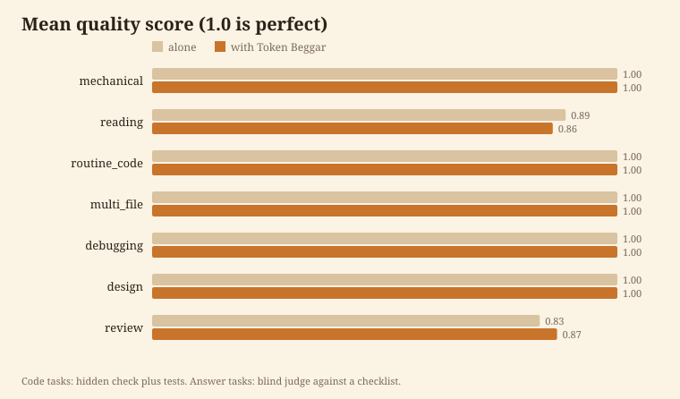

<p align="center"></p>

# Token Beggar

**Begs every token back. Same answers, fewer tokens.**

[English](README.md) | [Traditional Chinese](README.zh-TW.md)


I'm a skill for a terminal coding agent with one habit: before the big model does a job, I check whether a cheaper route can do it just as well. The chat model splits your prompt into subtasks and sends each one to the cheapest provider, model and effort that keeps the quality: a small model in a worker, an outside tool's CLI such as `agy`, or itself. Design, root causes and the final answer stay with the model you picked.

```
/plugin marketplace add Arthur031221/Token-Beggar
/plugin install token-beggar@token-beggar
```

Restart the agent or run `/reload-plugins`, then run `token-beggar doctor` to confirm the hooks run. Needs Python 3.10 or newer, standard library only.

At the end of every reply where I acted, you get one line:

```
Token Beggar: about 1.6x fewer tokens than Opus 5.5 high alone (est. 86k vs 135k) | exact edits | routed 1: haiku low x1
```

The first number (86k) is counted: the main chat plus every worker, input, output and cache. The second is that count times a ratio I measured, so it's an estimate and says so. Tokens used by an outside tool are shown apart, because they don't come out of your chat quota. If routing measured no gain for that kind of task, the line says that instead of claiming one.

## What it saves

All numbers are chat-side tokens (what your plan is billed for), with Opus 5.5 at high effort as the chat model. 21 tasks in 7 classes, 3 runs each, three arms with the same prompt and tools: the model alone, my first version (a fixed table of classes), and the dynamic router in this release.

| Arm | Tokens per task | Cost per task | Quality |
| --- | --- | --- | --- |
| Alone | 105,690 | $0.152 | 0.96 |
| Fixed table (v0.1) | 101,446 (1.04x fewer) | $0.122 | 0.96 |
| **Dynamic router (v0.2)** | **93,501 (1.13x fewer)** | $0.133 | **0.97** |

The dynamic router uses fewer tokens at equal or better quality, so it replaces the table. The table is cheaper in dollars, though: $0.122 against $0.133. Dollars weight tokens by the price of the model that used them, so the two measures can rank the arms differently. Both are measured and both are in the repository. Per class:

| Class | Tokens alone | Fixed table | Dynamic | Dynamic vs alone | Quality alone / table / dynamic |
| --- | --- | --- | --- | --- | --- |
| Multi-file feature | 160,462 | 135,395 | 112,791 | **1.42x** | 1.00 / 1.00 / 1.00 |
| Mechanical edits | 116,715 | 112,538 | 98,096 | **1.19x** | 1.00 / 1.00 / 1.00 |
| Bug root cause | 146,363 | 124,514 | 130,712 | 1.12x | 1.00 / 1.00 / 1.00 |
| Reading and summarising | 69,501 | 72,089 | 64,778 | 1.07x | 0.89 / 0.86 / 0.92 |
| Code review | 92,207 | 85,928 | 89,695 | 1.03x | 0.83 / 0.87 / 0.93 |
| Design | 62,063 | 55,779 | 62,190 | 1.00x | 1.00 / 1.00 / 0.97 |
| Routine code | 92,519 | 123,880 | 96,247 | 0.96x | 1.00 / 1.00 / 1.00 |

The honest headline is 1.13x over a mixed set and 1.42x on multi-file work. It's not 10x. The tasks are small and every worker pays a fixed cost to start, so the saving grows with task size. I treat anything under about 1.15x as no different from no saving: with 3 runs per arm that's inside the spread I saw.

The reading quality drop in v0.1 (0.89 to 0.86) was one checklist item on a synthesis task, plus noise. The dynamic router scores 0.92 on the same tasks. The routing rules were tuned on these 21 tasks over six iterations (the first card, a soft menu, never routed at all, and every variant is in `data/measured.json`), so this measures this setup. It doesn't forecast yours.

<p align="center"></p>

### The footer ratios

The footer needs a ratio for the model you run, the effort and the kind of task. I measured all of them: 4 models (Opus 5.5, Sonnet 5.5, Haiku 5.5, Fable 5.1), 5 efforts (low to max), 8 kinds of task, one small task per kind, each run alone and with the skill. That's 288 runs in print mode with JSON output. A single cell is noisy, so the footer quotes the pooled ratio of a model and kind (tokens summed over every effort measured). Ratio above 1 means fewer tokens with the skill.

| Kind | Opus 5.5 | Sonnet 5.5 | Haiku 5.5 | Fable 5.1 |
| --- | --- | --- | --- | --- |
| Multi-file feature | 1.73 | 0.62 | 0.98 | 1.71 |
| Exact edits | 1.57 | 1.13 | 1.60 | 1.42 |
| One function with tests | 1.48 | 1.24 | 1.38 | 1.43 |
| Design | 1.14 | 1.44 | 1.21 | 1.27 |
| Read and answer | 1.26 | 1.07 | 0.93 | 1.11 |
| Review | 0.87 | 1.40 | 1.05 | 1.21 |
| Bug fix | 1.04 | 0.98 | 0.93 | 1.36 |
| Summarise many files | 0.89 | 0.74 | 1.04 | 0.93 |

Below 1.15 the footer says "about the same" or "alone would likely use fewer", and where I have no ratio it prints the count only. Things to know before you lean on a number:

- Sonnet 5.5 as the chat model loses on multi-file features (0.62) and on reading many files (0.74): the worker start cost is larger than what it saves. The footer says so.
- Fable 5.1 was measured at low, high and max effort. Medium and xhigh are marked `interpolated` in `data/measured.json` and in the footer, and carry the pooled ratio. Everything else was run.
- Without the skill, the median task used about 3.4x the tokens at max effort that it used at medium, and 1.5x at xhigh. Running `max` for small jobs is the biggest single token cost I saw.
- One run per cell and arm. The spread across efforts inside one pooled ratio is in the data (`cell_min`, `cell_max`).

### Outside tools

With `agy` on the PATH and logged in, I measured three jobs where handing bulk work to an outside tool should save chat tokens: reading every carrier module into one sorted list, a first draft, and a second opinion on a design. 3 runs per arm, Opus 5.5 high.

| Job | Chat tokens alone | With the skill | Ratio | Handed to agy | Quality alone / with |
| --- | --- | --- | --- | --- | --- |
| Read many files | 59,097 | 61,714 | 0.96x | 3 of 3 | 1.00 / 1.00 |
| First draft | 97,103 | 97,870 | 0.99x | 1 of 3 | 1.00 / 1.00 |
| Second opinion | 38,826 | 42,160 | 0.92x | 0 of 3 | 0.75 / 0.67 |

This showed no saving. When the work was handed over (the reading job, every run, using 14,886 agy tokens in total), the chat total still came out level with working alone, because the files here are small: the chat model pays for the dispatch, the prompt and the check about as much as it would pay to read them. The second opinion was never handed over. I expect the gap to open on inputs of hundreds of thousands of tokens, but I haven't measured that, so I don't claim it. The Gemini CLI wasn't logged in on the machine I measured on, so Gemini isn't measured at all.

### How it was measured

- A small Python shop project. 21 tasks: 3 each for mechanical edits, reading, routine code, multi-file features, debugging, design and review.
- Same prompt, same allowed tools, same chat model and effort in every arm.
- Code tasks are scored by a hidden check plus the project tests. Answer tasks are scored against a checklist by a blind judge that doesn't see which arm wrote the text.
- Tokens are input + output + cache read + cache write of the chat and every subagent, from the agent's own JSON (`modelUsage`). An outside tool's tokens are counted apart.
- Raw runs: [`benchmark/results/raw`](benchmark/results/raw) (router), [`matrix/raw`](benchmark/results/matrix/raw) (footer ratios), [`agy/raw`](benchmark/results/agy/raw) (other AIs). Tables: [`report.md`](benchmark/results/report.md).
- Reproduce: `python3 benchmark/run.py --arms alone,beggar,dynamic`, then `score.py` and `report.py`. The matrix is `matrix.py run|score|fit` and the outside tool jobs are `agy_bench.py`. A full router pass costs about $20 in list price.

## Install

To try it for one session without installing, clone the repository and start the agent with `--plugin-dir ./Token-Beggar`.

<details>
<summary>Other hosts</summary>

The routing card, the worker and the hooks use features of the host above, so the plugin doesn't run in other agents. Two things do work. On a supported host, `agy`, `gemini` and `codex` are routing targets when they're installed. And `skills/token-beggar/SKILL.md` is plain Markdown you can copy into any agent that reads skills.
</details>

<details>
<summary>Turn it off</summary>

Start the agent with `TOKEN_BEGGAR=off` in its environment for one shell. Create a file named `off` in the state directory (`token-beggar env` prints it) for good. `/plugin uninstall token-beggar` removes it.
</details>

Details in [docs/install.md](docs/install.md).

## How I work

1. **Decompose.** A hook adds a menu to the first real prompt of a session and a one line reminder after it. The menu lists every provider, model and effort you can use, with what each is good and weak at, a capability score and a price. Very short prompts and slash commands get nothing. The chat model splits the prompt into subtasks.
2. **Choose per subtask.** Decision rules ask about size, ambiguity, risk, how much has to be read, and whether a test can verify the result. The cheapest combination that clears the bar wins. A one line answer or a short edit stays inline, since a worker starts with its own base context.
3. **Respect the ceiling.** The model and effort of your chat are the cap for models of the same vendor. If you run Sonnet at medium, nothing goes to Opus or to high effort. Other providers aren't capped unless you say so in the prompt: "agy max flash" keeps agy to its flash models and "no gemini" switches it off for the session.
4. **Check cheaply.** One test run or `git diff --stat`, not a second read of everything. Judgement and the final answer stay with the chat model.
5. **Report.** The Stop hook adds the footer above. The model doesn't write it. The hook counts the transcript, so the number can't be made up in prose.

Say `/token-beggar` or "token beggar" to switch me on for a prompt that didn't trigger me on its own.

### Outside tools as routes

`agy`, `gemini` and `codex` on the PATH, and MCP servers, appear on the menu. `token-beggar inventory` lists them and detects each tool's models (`agy models`). The prior is the host's own models first, then Codex, then Gemini, so bulk and first draft work can go out and anything that needs this conversation, edits files or is risky can't. I never send secrets: file names and text that look like keys are refused.

```
token-beggar ask agy --model gemini-3.8-flash-low --file 'src/**/*.py' "list every public function with its arguments"
token-beggar cap agy flash
```

`--file` takes globs and directories. When a tool answers with a usage limit I parse the error for the reset time and keep that tool (or that model) off the menu until then. If the text names no time, it's five hours for a quota and a day for a login problem. An outside answer is a draft. The chat model reads it before using it.

### Compaction

Works with no setup. The host compacts at a point derived from the context window, 33k tokens short of it by default. I find that point myself (`token-beggar window` prints it), so you don't need to set the compaction window variable. If you do set it, I use it.

- **Check often.** On every prompt and after every tool call in a long turn.
- **Warn early.** At 87.5 percent of the point, or 30k tokens before it, whichever comes first, I ask the chat model to judge whether it's in the middle of a step (edits unverified, a change half done across files, a plan in progress) and to save a note with `token-beggar note`, a few lines on the goal, what is done and what is next. A mechanical extract (the request, edited files, the last commands) is the fallback if the model doesn't.
- **Defer a mid-step compaction.** Exit code 2 from the `PreCompact` hook postpones an automatic compaction. I do it up to 3 times by 5 percent of the window each, never closer than 5k tokens to the level where the host refuses requests, and only when the note says mid-step. A manual `/compact` is never blocked.
- **Read it back.** After a compaction the session start hook puts the note back with the menu. A note written long before the compaction is labelled as old.

Tested in real sessions in print mode and a 100k window on 8 long documents read one by one: the warning arrived at 47k and 63k of a 67k point, the model wrote the note mid-step, two compactions were deferred, the host compacted once at 95k, and afterwards the model carried on from the note and listed all eight first words correctly. Limits: edits made inside a worker are invisible to me, so I neither defer for them nor list them. One tool result bigger than the margin before the point can jump past it. The host clamps the window to 100k to 1M. See [docs/architecture.md](docs/architecture.md).

### Check it and see what it did

`token-beggar doctor` lists what can quietly stop routing: an unsupported Python, an unwritable state directory, a worker model forced by the environment, logged hook errors, and whether the hook entry point runs. It exits 1 when something is broken.

`token-beggar stats` reads your own recent sessions (7 days by default, `--days N` to change it). Per worker model it prints how many workers ran, the tokens they used, what that cost, and what the same tokens would have cost at the model that started them. That last column is an upper bound on what delegation moved, not a net saving.

### Models

`data/models.json` lists the model families with price and default effort. A GitHub Action refreshes it every week from the vendor's public models page, and a local weekly check does the same for installed copies. `data/profiles.json` holds the capability and cost profiles and the decision rules the menu is built from.

## Similar tools

I looked at these before building this and kept what they do well. The differences are factual, not a ranking.

| Tool | What it does | How I differ |
| --- | --- | --- |
| Local router proxies (for example the musistudio project) | A proxy that sends the agent's requests to other providers by scenario | I don't touch the API path. I route inside the session with the agent's own subagents, and keep the chat model as a cap |
| The subagent model variable and `model:` in agent files | Pin one model to subagents | Static: it doesn't grade the task or the ceiling, and it can't choose effort per call |
| ccusage style meters | Report spend after the fact | I act before the spend, and my multiplier comes from a benchmark rather than from your history |
| Token saving guides and context skills | Shorter prompts, smaller context, fewer reads | Compatible with me. I only change who does the work |

If I missed one, open an issue.

## Limits

- Savings on small tasks are small because of the worker start cost. Under about 1.15x I can't tell it from none.
- The router comparison covers one project and one chat model and effort (Opus 5.5, high). The footer ratios cover four models and five efforts, one run per cell, so a single cell is noisy and 16 Fable cells are interpolated.
- The dynamic router costs more dollars than the fixed table ($0.133 against $0.122 per task) while using fewer tokens. If you pay by the dollar rather than by the quota, check that trade for your mix.
- No saving from another AI is shown on the small files I tested, and the Gemini CLI wasn't measured.
- The footer is estimated from a ratio. The count in it is real, and the "vs" figure isn't a measurement of your task. When the host runs the Stop hook before the last message is written I wait up to 4 seconds for it, and print "at least" if it still isn't there.
- Hooks can't see the chat model, so the model is read from the transcript first, then the launch flags of the running agent process, the environment and settings. If none says which model runs, the card says the ceiling is unknown and tells me never to go above my own model.
- Workers load your project memory file like any session. The benchmark project has none, so that cost isn't in the numbers.
- A task graded by a model can be graded wrong. The checks in the benchmark are there to catch that, not to remove it.

More in [docs/usage.md](docs/usage.md), [docs/config.md](docs/config.md) and [docs/architecture.md](docs/architecture.md). Contributions: [CONTRIBUTING.md](CONTRIBUTING.md). MIT license.

Assisted by Claude/Codex.
