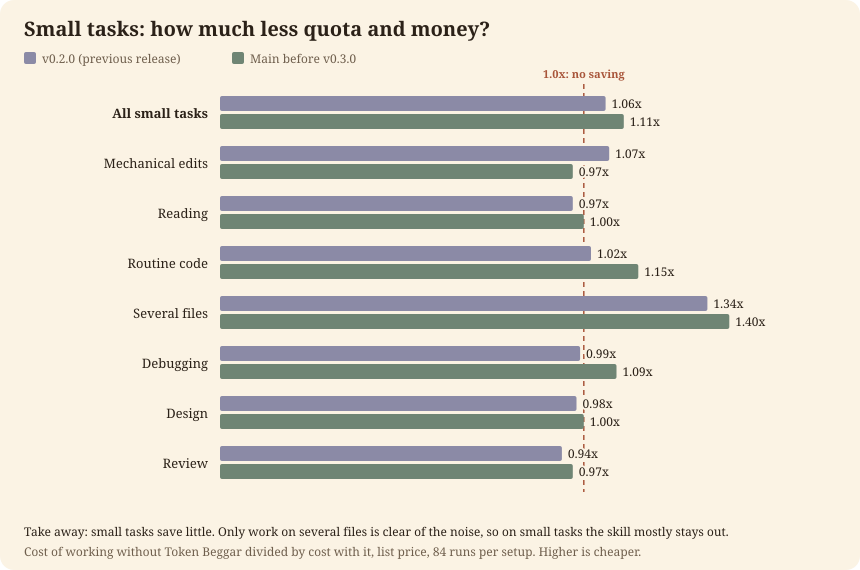
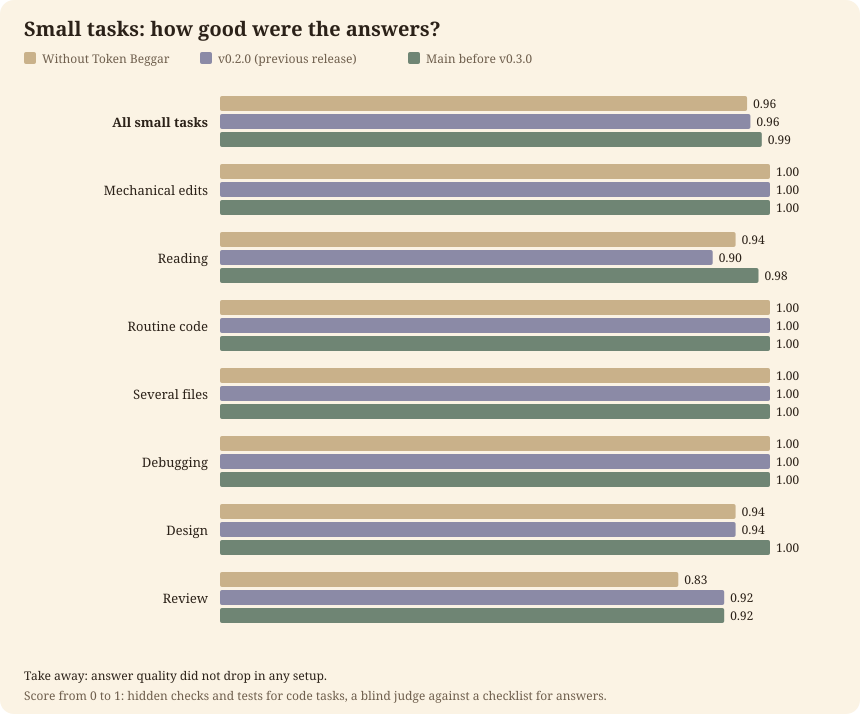

# Token Beggar 🪙: 相同的回答，更低的帳單

<picture>
  <source media="(prefers-color-scheme: dark)" srcset="assets/banner-dark.svg">
  
</picture>

<p align="center">
  <a href="https://github.com/Arthur031221/Token-Beggar/actions/workflows/ci.yml"></a>
  <a href="https://github.com/Arthur031221/Token-Beggar/releases"></a>
  <a href="pyproject.toml"></a>
  <a href="pyproject.toml"></a>
  <a href="LICENSE"></a>
</p>

[English](README.md) | [繁體中文](README.zh-TW.md) | [简体中文](README.zh-CN.md) | [日本語](README.ja.md) | [한국어](README.ko.md) | [Español](README.es.md) | [Français](README.fr.md) | [Deutsch](README.de.md) | [Português](README.pt-BR.md)

Token Beggar 是 Claude Code 的外掛程式。在大型模型執行工作之前，它會先檢查是否有更便宜的模型能做得一樣好。小型任務會保留在對話中。大型任務（例如在尚未閱讀過的儲存庫中修復 bug）會指派給一個更便宜的 worker，隨後對話會檢查整個 diff 並執行測試。設計、根本原因與最終回答則仍由你選擇的模型負責。

**在 18 個真實 bug 修復中，它消耗的額度與費用比單獨運作少了 1.42x，且隱藏測試通過比例相當（69% 對比 70%）。**

它在你的電腦上、在你的 Claude Code 工作階段中執行。它使用你已登入的 Claude Code，絕不向任何地方傳送關於你的任何資訊，並且只寫入它自己的資料夾。[具體運作內容](docs/on-your-machine.md)。

[安裝](#安裝) · [快速開始](#快速開始) · [結果](#結果) · [運作方式](#運作方式) · [常見問題](#常見問題) · [說明文件](#說明文件) · [變更記錄](CHANGELOG.md)

<p align="center"></p>

> [!TIP]
> 不確定是否正常運作？執行 `token-beggar doctor`。它會列出可能悄悄停止路由的因素，並在有問題時以結束代碼 1 退出。

## 安裝

需要 Claude Code 與 Python 3.10 或更新版本。它僅使用標準函式庫。

```
# From the marketplace in this repository (inside Claude Code)
/plugin marketplace add Arthur031221/Token-Beggar
/plugin install token-beggar@token-beggar
```

```
# Try it for one session without installing
git clone https://github.com/Arthur031221/Token-Beggar
claude --plugin-dir ./Token-Beggar
```

```
# From a shell, the same two steps as the first block
claude plugin marketplace add Arthur031221/Token-Beggar
claude plugin install token-beggar@token-beggar
```

重新啟動代理或執行 `/reload-plugins`。更多資訊請參閱 [docs/install.md](docs/install.md)，包括如何在其他能讀取技能的代理中使用此技能。

## 快速開始

按照你平常的方式工作即可。在工作階段的第一個正式提示中，hook 會加入一張簡短的路由卡片，對話模型會評估任務規模。在有進行路由且測得節省的回覆結尾，你會看到一行提示：

```
Token Beggar: about 1.4x less quota than Opus 5.5 high alone, saved about $0.21 (est.) | large task | routed 1: haiku medium x1
```

此倍數是針對你的模型與 effort 所測得未使用 Token Beggar 相較於使用時的牌價成本比值。金額則是該回覆本身的成本乘以該比值減一。兩者皆為估計值並已標明。該行從不計算 token 數量，且在低於 1.15x 時不顯示倍數，因為那屬於各次執行之間的波動範圍。

若要針對未觸發它的提示手動開啟，請輸入 `/token-beggar`。接著確認各 hook 正常執行：

```
token-beggar doctor
```

## 結果

以 Opus 5.5 搭配 high effort 作為對話模型。成本為對話及每個 worker 的牌價，包含快取。區間為 95 百分比。唯有達到 1.15x 或更高且整個區間皆高於 1.0x 時，才視為有節省。

這裡的版本是指此儲存庫帶有標籤的發布版本。**未使用 Token Beggar (Without Token Beggar)** 是對話模型單獨運作。**v0.3.0 (本次發布) (v0.3.0 (this release))** 是這個版本。**v0.2.0 (前次發布) (v0.2.0 (previous release))** 是它前一個版本。高難度基準測試是與 **v0.3.0 前的 main (Main before v0.3.0)** 比較，即本次發布前 main 分支上的卡片，因為 v0.2.0 本身並未在其上執行。

### 高難度任務：真實 Bug 修復

來自 12 個開源 Python 專案（Django、Sphinx、pylint、sympy、click 等）的 18 個已合併 Pull Request。對話從修復前一個 commit 搭配 issue 說明文字開始，並由維護者新增的測試進行評分，對話模型從未看過這些測試。每個任務執行 3 次，每個設定執行 54 次。

| 設定 | 每次執行成本 | 相較未使用 Token Beggar 的倍數 | 解決率 |
| --- | --- | --- | --- |
| 未使用 Token Beggar | $0.69 | 1.00x | 70% |
| v0.3.0 前的 main | $0.45 | 1.54x (1.46 to 1.64) | 65% |
| v0.3.0 (本次發布) | $0.49 | 1.42x (1.33 to 1.51) | 69% |

<p align="center"></p>

<p align="center"><em>18 個高難度任務中有 17 個在搭配 Token Beggar 時成本更低，而唯一成本較高的任務（structlog-exception-outside）約多花費 10%。</em></p>

<p align="center"></p>

<p align="center"><em>修復問題的比例與單獨運作相近，這證實了節省並未以犧牲品質為代價。</em></p>

成本降低 29%（$0.49 對比 $0.69），問題修復比例維持持平。v0.3.0 前的 main 更加便宜（1.54x）並解決了 65%，這在 54 次執行中僅少了 2 次，因而落在波動範圍內。它未被發布是因為在數個任務中它於 2 或 3 個回合後便停止，且在 click-format-filename 任務中以錯誤修復停止（3 次中 0 次成功，相較單獨運作 3 次全中）。v0.3.0 的成本高於它，因為它在回答前會完整閱讀 diff。

這項測試未顯示的部分：同等的程式碼品質。由小型模型進行的盲測審查對 v0.3.0 的 diff 給出較低評分（以 0 到 2 為標準，得分為 0.94，相較單獨運作的 1.33 以及 v0.3.0 前 main 的 1.15），且其與隱藏測試的一致性較弱。耗時方面與單獨運作持平（168 秒對 187 秒），並未更快。

### 小型任務

7 個類別共 28 個小型任務，每個執行 3 次，每個設定共 84 次執行。其中 21 個用於調校，7 個保留未動。此基準測試在 v0.3.0 出現之前即已執行，因此最後一欄為 v0.3.0 前的 main。在兩種卡片中小型任務皆保留在對話內，因此預期 v0.3.0 會有一致表現，但未重新執行。

| 群組 | 未使用 Token Beggar | v0.2.0 (前次發布) | v0.3.0 前的 main | v0.3.0 前的 main 相較未使用 |
| --- | --- | --- | --- | --- |
| 全部 28 個任務 | $0.148 | $0.139 | $0.134 | 1.11x (1.08 to 1.14) |
| 7 個保留任務 | $0.134 | $0.136 | $0.129 | 1.04x (0.99 to 1.11) |
| 多個檔案 | $0.260 | $0.194 | $0.185 | 1.40x (1.27 to 1.55) |
| 常規程式碼 | $0.152 | $0.149 | $0.132 | 1.15x (1.09 to 1.22) |

<p align="center"></p>

<p align="center"><em>在小型任務中，只有多檔案類別有明顯節省；其餘則落在虛線附近。</em></p>

<p align="center"></p>

<p align="center"><em>小型任務的回答品質在任何設定下均未下降。</em></p>

小型任務節省甚微。其餘五個類別（機械式修改、閱讀、除錯、設計、審查）結果介於 0.97x 到 1.09x 之間，屬於雜訊範圍。綜合結果（1.11x）低於 1.15x 的標準，因此未列為節省，且在保留任務上的表現落在單獨運作的波動範圍之內。每個 worker 約 $0.10 的啟動成本佔據了 $0.15 任務的大部分費用，這就是為什麼小型任務保留在對話中處理。回答品質在任何設定下均未下降。

> [!IMPORTANT]
> **適用與不適用的情境。** 它在 Opus 5.5 搭配 high effort 的大型任務上發揮效用（實測 1.42x），並在 Fable 5.1 的所有 effort 以及 Opus at max 上有所助益，這些情境下小型任務亦測得節省。在其他 effort 的 Opus 以及 Sonnet 5.5 上，它會將小型任務保留在對話中，並將大型任務指派給 worker。大型任務的節省僅針對 Opus high 進行量測，因此在 Sonnet 上屬於未量測，頁尾將僅列出成本而不顯示倍數。在最便宜的模型 Haiku 5.5 上，它不會有任何動作。若你的主要工作為單一檔案的小幅修改，請預期幾乎不會有任何變化。

各表格、任務清單、曾經嘗試並還原的調整項目（使用外部工具大量讀取、提早壓縮）以及如何重現所有內容，均收錄於 [docs/benchmark.md](docs/benchmark.md)。所有原始執行記錄皆位於 [`benchmark/results`](benchmark/results)。

## 運作方式

1. **查詢模式。** 根據你對話的模型與 effort，從 `data/measured.json` 中選取三種模式之一。小型任務測得節省達 1.15x 以上、或該模型從未進行量測時，採用 `full`（提供完整的模型、effort 與外部工具選單）。其餘情況採用 `sized`。最便宜的模型則為 `off`。`token-beggar mode --all` 可印出此矩陣，而 `TOKEN_BEGGAR_MODE=full|sized|off` 可強制指定模式。
2. **評估任務規模。** 在 `sized` 模式下，卡片指引小型任務直接在對話中執行，而大型任務則將重現、探索、修復與執行測試的完整清單交由單一 worker 處理。大型任務是指模型尚未閱讀過的儲存庫中的 issue、超過約 5 次工具呼叫、動及多個檔案，或是包含編輯與測試的循環。步驟超過約 5 步的小型任務將轉變為大型任務。
3. **檢查 worker 的工作成果。** Worker 會在 150 字以內回報，並列出具有相同症狀的所有位置。對話端會讀取完整的 `git diff`、執行測試、核對該清單，若有遺漏則將同一個 worker 再次派回。
4. **遵循上限。** 你對話的模型與 effort 會做為同一廠商其他模型的上限。在 Sonnet medium 上，絕不會將工作分配給 Opus 或 high effort。
5. **回報。** Stop hook 會加入頁尾。此頁尾並非由模型撰寫，因此數字無法在文字中憑空捏造。

門檻值的由來：1.15x 大致等於多次重複執行所觀察到的波動範圍，因此較低的比值不被視為節省。大型任務的 1.42x 比值來自上述高難度基準測試。詳情請參閱 [docs/benchmark.md](docs/benchmark.md#models-and-efforts)。

### 各組件如何協同運作

- **Skill**：對話模型讀取的路由規則。[`skills/token-beggar/SKILL.md`](skills/token-beggar/SKILL.md)，詳見 [docs/usage.md](docs/usage.md)。
- **Hooks**：七個小型 hook，負責加入卡片、限制 worker 不得超過上限、保護壓縮機制以及加入頁尾。[docs/on-your-machine.md](docs/on-your-machine.md)。
- **Worker**：擁有六個工具並負責執行委派工作之單一代理。[`agents/beggar-worker.md`](agents/beggar-worker.md)，參見 [docs/architecture.md](docs/architecture.md)。
- **CLI**：`token-beggar` 提供 `doctor`、`mode`、`stats`、`inventory`、`ask` 等指令。[docs/usage.md](docs/usage.md#commands)。

它也能保護長工作階段。它會偵測主機壓縮上下文的切入點，並在壓縮前提示對話儲存簡短筆記，且能在步驟執行途中延後自動壓縮，事後再將筆記放回。參見 [docs/architecture.md](docs/architecture.md)。

## 在你的電腦上的行為

> [!NOTE]
> 以下所有內容亦收錄於 [docs/on-your-machine.md](docs/on-your-machine.md)，包含 hook 對照表。

- **讀取**：目前工作階段的對話記錄（用以計算成本並掌握上下文大小與模型）、透過 `ps` 取得對話程序的啟動旗標，以及用於模型與 effort 的環境與設定檔。這些資訊絕不會離開你的電腦。
- **執行**：呼叫 `python3 -m token_beggar hook <name>` 的七個 hook。若 hook 發生失敗，會記錄錯誤並以 0 退出，因此絕不會中斷你的工作階段。Worker 均在你自己的權限設定下執行。
- **傳送**：每週下載一次廠商的公開模型頁面以保持價格最新（`TOKEN_BEGGAR_OFFLINE=1` 可停止下載）。只有在你已安裝且明確指定該外部 AI 工具（`agy`、`gemini`、`codex`），或者讀取量達約 100k token 以上時，文字才會傳送給外部 AI 工具。檔名與看似金鑰的文字均會被拒絕傳送。
- **寫入**：僅單一資料夾 `~/.claude/token-beggar`。不寫入代理設定，亦不寫入你的專案檔案。
- **關閉方式**：可在單一 shell 中設定 `TOKEN_BEGGAR=off`，在該資料夾內建立名為 `off` 的檔案永久關閉，或執行 `/plugin uninstall token-beggar`。

## 設定

你不需要進行任何設定。預設值均來自量測結果。

| 設定 | 作用 |
| --- | --- |
| `TOKEN_BEGGAR=off` | 在此 shell 中關閉 |
| `TOKEN_BEGGAR_MODE=full\|sized\|off` | 強制指定模式以取代量測模式 |
| `TOKEN_BEGGAR_EARLY=1` | 在長工作階段中建議提早壓縮（實測成本較高，故預設關閉） |
| `TOKEN_BEGGAR_OFFLINE=1` | 停用每週下載 |
| `token-beggar cap agy flash` | 限制外部工具僅使用其 flash 模型 |

所有設定（包含像是「no gemini」的提示詞）：[docs/config.md](docs/config.md)。

## 限制事項

- 小型任務節省有限。低於約 1.15x 時無法與無節省區分，而小型任務的綜合結果（1.11x）正低於此門檻。
- 高難度基準測試僅涵蓋單一對話模型與 effort（Opus 5.5，high）及 Python 專案。Sonnet、Haiku 與 Fable 在大型任務上的表現尚未量測。
- 解決率 69% 對 70% 落在波動範圍內屬於持平，且盲測審查對 v0.3.0 的 diff 給予較低評分。並未證實程式碼品質完全相當。
- 已發布的 v0.2.0 未在高難度任務上執行，而 v0.3.0 未在小型任務上重新執行。
- 小型檔案未發現外部 AI 工具帶來節省，且 Gemini 尚未量測。大量讀取情境亦未量測。
- 在測試的單一長工作階段中提早壓縮成本較高，因此為選用功能。
- 頁尾是根據量測比值估算，而非來自你的具體任務。各 hook 無法直接取得對話模型，因此會從對話記錄、程序旗標、環境變數與設定中依序讀取。若均未指明，卡片將標示上限未知。
- Worker 如同一般工作階段會載入你的專案記憶檔。基準測試專案中沒有此檔案，因此該成本未計入數據中。

## 常見問題

**它會改變我的回答嗎？** 在高難度任務中，它修復了 69% 的 issue，相較單獨運作的 70%，在波動範圍內持平。它並不宣稱程式碼品質完全同等。

**為什麼有時沒有頁尾？** 僅在有路由任務且針對你的模型、effort 及任務類型測得 1.15x 以上的節省時，才會顯示頁尾。

**它在 Sonnet 或 Haiku 上會有任何動作嗎？** 在 Haiku 上沒有任何動作，因為它是最便宜的模型，沒有更便宜的模型可以派工。在 Sonnet 上，小型任務測得負效益（約 0.85x），因此保留在對話中處理，大型任務則指派給 worker，但大型任務的節省尚未量測。

**它會消耗我的額度嗎？** Worker 會以更便宜的模型消耗你的標準 Claude 額度。外部 AI 工具則消耗其自身的額度，不會消耗你的額度。

**有任何東西會傳送到伺服器嗎？** 僅有不包含任何個人資料的每週模型頁面下載，以及你交給所指定外部工具的檔案。請參閱[在你的電腦上的行為](#在你的電腦上的行為)。

**還有哪些工具與它類似？** 路由代理伺服器（router proxies）會依情境將 API 請求轉發至其他供應商；子代理模型變數則將單一模型固定分配給子代理；而像是 ccusage 這類的計量工具則是在事後回報支出。Token Beggar 則是在工作階段內運作，評估任務與上限，其倍數來自基準測試而非你的歷史記錄。它能與更短的提示詞和更小的上下文搭配使用。若有工具未收錄於此，歡迎提出 issue。

## 說明文件

| 目標 | 從這裡開始 |
| --- | --- |
| 安裝或在單一工作階段中試用 | [docs/install.md](docs/install.md) |
| 了解路由項目與相關指令 | [docs/usage.md](docs/usage.md) |
| 查看在你的電腦上的行為 | [docs/on-your-machine.md](docs/on-your-machine.md) |
| 修改設定或規則 | [docs/config.md](docs/config.md) |
| 理解各組件與模式 | [docs/architecture.md](docs/architecture.md) |
| 檢驗數據或進行重現 | [docs/benchmark.md](docs/benchmark.md) |
| 查看變更內容 | [CHANGELOG.md](CHANGELOG.md) |

## 開發

```
python3 -m unittest discover -s tests -t .
cd benchmark && python3 selftest.py
uvx ruff check . && uvx ruff format --check .
```

## 參與貢獻

歡迎提出 Issue 與 Pull Request。對卡片、skill 或 `data/profiles.json` 的修改，需在變更前後各執行一次基準測試，並同時列出退步與進步的結果。詳情請參閱 [CONTRIBUTING.md](CONTRIBUTING.md)。

## 授權條款

MIT © Arthur031221

Assisted by Claude/Codex.
