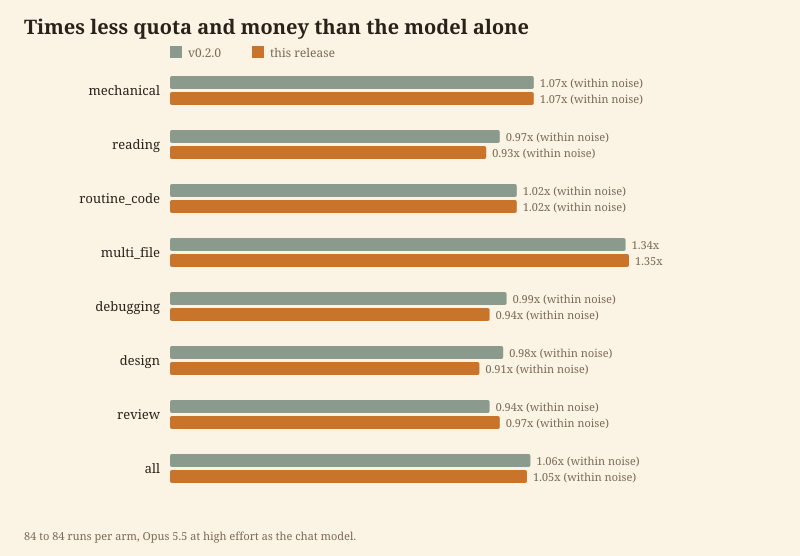

<p align="center"></p>

# Token Beggar（Token 乞丐）

**把每個 token 都乞討回來。答案一樣，帳單只剩一小部分。**

[English](README.md) | [繁體中文](README.zh-TW.md)


我是給終端機程式代理用的技能，只有一個習慣：大模型動手之前，先問便宜的模型能不能做得一樣好。讀記錄檔、改名、跑測試迴圈交給小模型的 worker。設計與找根本原因，留給你選的那個模型。

```
/plugin marketplace add Arthur031221/Token-Beggar
/plugin install token-beggar@token-beggar
```

重新啟動代理，或執行 `/reload-plugins`，再執行 `token-beggar doctor` 確認 hook 正常運作。需要 Python 3.10 以上，只用標準函式庫。

## 省多少

在 7 類共 21 個任務上實測，每個任務各跑 3 次，分成有我與沒有我兩組。對話模型是 Opus 5.5，effort 為 high。費用是代理自己回報的用量，以公開牌價計算。

| 類別 | 沒有我 | 有我 | 便宜幾倍 | 品質（沒有我 / 有我） |
| --- | --- | --- | --- | --- |
| 多檔案功能 | $2.47 | $1.58 | **1.56x** | 1.00 / 1.00 |
| 機械式修改 | $1.11 | $0.80 | **1.4x** | 1.00 / 1.00 |
| 閱讀與摘要 | $0.91 | $0.75 | 1.21x | 0.89 / 0.86 |
| 設計 | $0.93 | $0.82 | 1.14x | 1.00 / 1.00 |
| 一般程式碼 | $1.47 | $1.32 | 1.12x | 1.00 / 1.00 |
| 找錯誤根因 | $1.45 | $1.29 | 1.12x | 1.00 / 1.00 |
| 程式碼審查 | $1.21 | $1.13 | 1.07x | 0.83 / 0.87 |
| **每組共 63 次執行** | **$9.56** | **$7.69** | **1.24x** | **0.96 / 0.96** |

重點數字是多檔案任務 1.56 倍、一般混合工作 1.24 倍，不是 10 倍。測試任務都很小，而每個 worker 啟動都有固定成本，所以任務越大省越多。

小數字要小心看。設計、找根因與審查從不交給 worker，卻也便宜了 1.07 到 1.14 倍。那是每次執行之間的變動，加上路由卡似乎讓對話模型走了較短的路。所以低於約 1.15 倍的差距，我視為與沒有省錢無法區分。超過這條線的有三類：多檔案、機械式修改與閱讀。閱讀伴隨小幅品質下降，見下一段。

我是乞丐，不是魔術師。便宜的模型守不住品質時，我就不插手。程式碼審查在我第一輪設計中交給 worker，結果是 0.86 倍，所以現在留在原對話內。閱讀仍交給 worker，品質是 0.86 對 0.89，平均差一個檢查項目，落在評審的雜訊範圍內，但不能證明沒有損失。路由是用這 21 個任務調整的，所以這張表是在量測這個環境，不是對你環境的預測。

<p align="center"></p>

### 測量方法

- 在一個小型 Python 商店專案上跑 21 個任務：機械修改、閱讀、一般程式碼、多檔案功能、除錯、設計、審查各 3 個。
- 每個任務兩組，提示相同、允許的工具相同、對話模型相同（Opus 5.5，high）。一組裝了外掛，一組沒有。
- 程式碼任務用隱藏檢查加專案測試計分。文字回答任務由盲審評分員依檢核表計分，評分員看不出是哪一組產生的。
- 費用與 token 數來自 代理在 print 模式下輸出的 JSON。原始結果在 [`benchmark/results/raw`](benchmark/results/raw)，分數在 [`scores.json`](benchmark/results/scores.json)，表格在 [`report.md`](benchmark/results/report.md)。
- 重現方式：`python3 benchmark/run.py && python3 benchmark/score.py && python3 benchmark/report.py`。完整跑一次以牌價計約 18 美元。

## 安裝

只想試一個 session、不安裝：複製此儲存庫，再用 `--plugin-dir ./Token-Beggar` 啟動代理。

<details>
<summary>Codex CLI、Gemini CLI 與其他環境</summary>

路由卡、worker 與 hook 都使用上述代理的功能，所以外掛無法在其他環境執行。可以用的是：在支援的代理上，本機裝了 `codex`、`agy` 與 `gemini` 時會把它們當額外的 worker。`skills/token-beggar/SKILL.md` 是純 Markdown，可以複製到任何讀取技能的代理。
</details>

<details>
<summary>關閉</summary>

單次 shell：啟動代理時在環境變數設 `TOKEN_BEGGAR=off`。永久關閉：在狀態目錄（`token-beggar env` 會印出路徑）建立名為 `off` 的檔案。移除：`/plugin uninstall token-beggar`。
</details>

詳見 [docs/install.md](docs/install.md)。

## 運作方式

1. **分級。** hook 會在一個 session 的第一個正式提示加上一張含 7 類路由表的卡片，之後的提示只加一行提醒。太短的提示與斜線指令不會加。我在讀任何程式碼之前先替任務分級。
2. **遵守上限。** 你對話使用的模型與 effort 就是同一供應商模型的上限。你用 Sonnet medium，我就絕不派工給 Opus 或 high effort。其他供應商不受限，除非你自己設限，例如「agy max flash」。
3. **划算才委派。** 需要大量工具呼叫或大量讀檔的工作交給有獨立上下文的 worker。短回答、設計與最後定稿留在原對話。
4. **便宜地驗收。** 跑一次測試或 `git diff --stat`，不重讀所有檔案。
5. **回報。** 委派後的回覆我會加一行，例如 `Token Beggar: about 1.56x less spend than the top model at high effort alone (measured, multi_file)`。倍數只取自上面的基準測試表，只限 1.15 倍以上的類別，而且只有你的模型與 effort 跟實測相同時才給數字，否則這一行不寫數字。

某個提示沒有自動觸發我時，輸入 `/token-beggar` 或「token beggar」就能啟用。

### 檢查與回顧

`token-beggar doctor` 會列出可能默默讓路由失效的原因：Python 版本不支援、狀態目錄無法寫入、環境變數強制指定了 worker 模型、沒有設定壓縮視窗、hook 曾記錄錯誤，以及 hook 入口是否能執行。有東西壞掉時結束碼為 1。

`token-beggar stats` 會讀你自己最近的 session（預設 7 天，可用 `--days N` 調整），依 worker 模型列出執行次數、用掉的 token、實際花費，以及同樣的 token 若由啟動它的模型來做要花多少。最後一欄只是委派轉移的金額上限，不是淨節省，因為對話模型不會用一模一樣的 token。實測的淨節省仍以上面的表格為準。

### 模型清單

`data/models.json` 依版本由新到舊列出各模型系列、價格與預設 effort。GitHub Action 每週從 供應商的公開模型頁面更新一次，已安裝的副本也有本機每週檢查。worker 呼叫因用量上限失敗時，`token-beggar exhausted <alias>` 會標記該模型，路由在幾小時內跳過它。卡片也會列出 PATH 上的 `codex`、`agy`、`gemini`。

### 壓縮（compaction）

對話接近壓縮點時我會提醒。若你正做到一個步驟中間，我最多延後 3 次壓縮，並請你先完成該步驟並跑測試。任何壓縮之前，我會把目標、已修改檔案與未完成步驟寫成筆記放在狀態目錄，壓縮後由 session start hook 讀回。

提醒與延後都需要你設定代理的壓縮視窗環境變數（`token-beggar env` 會列出名稱），因為我不會去猜你模型的視窗大小。沒設定時我只寫筆記。worker 內部做的修改在主對話紀錄中看不到，所以不會觸發延後，也不會列進筆記。除了延後之外，我無法改變代理何時壓縮，而且這個設定有下限，視窗設得太小根本不會觸發壓縮。我實測了 60k 與 100k。詳見 [docs/architecture.md](docs/architecture.md)。

## 類似工具

動手前我看過這些工具，並保留它們做得好的部分。差異只陳述事實，不排名。

| 工具 | 做什麼 | 我的差異 |
| --- | --- | --- |
| 本機路由代理（例如 musistudio 的專案） | 代理伺服器，依情境把代理的請求轉給其他供應商 | 我不碰 API 路徑，而是在 session 內用代理自己的 subagent 分派，並以對話模型為上限 |
| subagent 模型環境變數與 agent 檔的 `model:` | 把單一模型固定給 subagent | 靜態設定：不替任務分級、不管上限，也不能逐次選 effort |
| ccusage 類的用量表 | 事後回報花費 | 我在花費之前行動，倍數來自基準測試而非你的歷史紀錄 |
| 省 token 教學與上下文類技能 | 更短的提示、更小的上下文、更少讀檔 | 可以與我並用。我只改變由誰來做工作 |

如果漏了哪個，請開 issue。

## 限制

- 單一任務低於約 0.15 美元時，因 worker 啟動成本，節省有限。
- 基準測試只涵蓋一個專案、一個對話模型與一個 effort。其他組合的卡片不會附實測數字。
- hook 看不到對話模型，所以模型先從 transcript 判斷，其次是執行中代理程序的啟動旗標、環境變數與設定。effort 取自同樣的旗標、環境變數與設定。若都無法判斷，卡片會寫明上限未知，並要求我不得超過自己的模型。
- worker 和一般 session 一樣會載入專案的記憶檔。基準測試的專案沒有這種檔案，所以這項成本不在數字裡。
- 每個任務每組只跑 3 次。低於約 15% 的差距，落在我看到的每次執行之間的變動範圍內。
- 後期發現一個評分錯誤：過期的 bytecode 讓某個除錯任務的 6 次執行中有 5 次，正確的修正被誤判為失敗。評分器現在會在檢查前清除 bytecode，兩組都已重新評分。
- 由模型評分的任務可能評錯。基準測試中的檢查是用來抓出這種情況，不是消除它。

更多內容見 [docs/usage.md](docs/usage.md)、[docs/config.md](docs/config.md) 與 [docs/architecture.md](docs/architecture.md)。貢獻方式見 [CONTRIBUTING.md](CONTRIBUTING.md)。MIT 授權。

Assisted by Claude/Codex.
